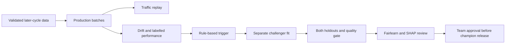

# AI-Assisted Health and Wellness Awareness Platform

[](https://github.com/Rishi799/health-wellness-mlops/actions/workflows/ci.yml)
[](https://github.com/Rishi799/health-wellness-mlops/actions/workflows/cd.yml)

An end-to-end MLOps project that produces an educational cardiometabolic awareness score (0–100, Low / Moderate / High) from health and lifestyle data. It demonstrates data validation, DVC versioning, MLflow tracking and registry, FastAPI serving, containerisation, CI/CD, drift monitoring, subgroup assessment, explanations and reviewed challenger retraining. The label concerns prior self-reported diagnosis; the score is not a validated forecast of future disease.

> **Disclaimer:** awareness and educational tool only — not a medical diagnosis.

**Live API:** https://health-wellness-api.onrender.com — interactive docs at [`/docs`](https://health-wellness-api.onrender.com/docs), health at [`/health`](https://health-wellness-api.onrender.com/health). The free instance sleeps after about 15 minutes idle; the first request can take up to a minute.

| | |
| --- | --- |
| Course | AI252TA Machine Learning Operations — Topic 27 |
| SDGs | 3 Good Health and Well-being · 4 Quality Education |
| Team | Rishi Agarwal · Rishabh · Rhea · Niranjan (John) |
| Phase | Phase 2 live; Phase 3 monitoring and challenger implementation under review |

## Dataset
NHANES public-use CDC data: 15 source files per cycle, joined using the survey participant key `SEQN`, which is excluded from serving inputs. The raw 2017–2018 demographics file has 9,254 participants and the later 2021–2023 file has 11,933. After adult/known-label filtering, there are 5,536 original-cycle and 7,783 later-cycle records. The later cycle is now cleaned, validated and used for Phase 3 monitoring and a separately split challenger experiment. See [data documentation](DATA_README.md) and `DATA_DICTIONARY.xlsx`.

## Prediction target
`cardiometabolic = 1` if an adult (20+) was ever told by a doctor they have **diabetes (borderline counts as yes), heart failure, coronary heart disease, angina, a heart attack or a stroke**; `0` if all six answers are no. Adults whose answers leave the target unknown (only "don't know" instead of "no") are dropped.

| 2017–2018 | Value |
| --- | --- |
| Adults in the dataset | 5,536 |
| At risk (`cardiometabolic = 1`) | 1,444 (26.1%) |
| Train / test (stratified 80/20, seed 42) | 4,428 / 1,108 — 26.1% at risk in each |

The target is imbalanced (about 1 in 4), so models are judged on ROC-AUC and recall, not accuracy.

## Data pipeline (Phase 1)
Every step is a DVC stage in `dvc.yaml`; `dvc repro` rebuilds everything from the raw files.

```
raw NHANES ─► people · body · lifestyle · mental ─► merge ─► validate ─► split ─► train.csv / test.csv
```

| Stage | Script | Output |
| --- | --- | --- |
| people_2017 | `src/data/people.py` | adults 20+, target |
| body_2017 | `src/data/body.py` | body measures, blood pressure, labs |
| lifestyle_2017 | `src/data/lifestyle.py` | smoking, alcohol, activity, sleep, diet |
| mental_2017 | `src/data/mental.py` | PHQ-9 score and category |
| merge_2017 | `src/data/merge.py` | one row per adult, 31 columns |
| validate_2017 | `src/data/validate.py` | pandera checks on every table (358 checks); stops the pipeline on failure |
| split | `src/data/split.py` | `data/processed/train.csv`, `test.csv` (settings in `params.yaml`) |

Columns that must **not** be used as model features (data leakage): `seqn`, the six target parts (`diabetes`, `heart_failure`, `coronary_heart_disease`, `angina`, `heart_attack`, `stroke`), `hba1c` (HbA1c ≥ 6.5% is the diagnosis of diabetes) and `diet_quality` (not available in 2021–2023).

## Phase 2: from model to service

```
compare_models.py ─► MLflow Model Registry ─► export_model.py ─► Docker image ─► Render
 (7 models)           cardiometabolic-risk-model   models/model.skops    (GHCR)        public API
                      alias champion → v2          (tracked by DVC)
```

### Model comparison
Seven models on the same test set (1,108 adults), tracked in MLflow on DagsHub. Logistic Regression is the champion.

| Model | ROC-AUC | Recall | Precision | F1 |
| --- | --- | --- | --- | --- |
| **Logistic Regression** | **0.850** | **0.827** | 0.549 | **0.660** |
| Gradient Boosting | 0.840 | 0.502 | 0.650 | 0.566 |
| Random Forest | 0.840 | 0.616 | 0.599 | 0.608 |
| Extra Trees | 0.836 | 0.367 | 0.663 | 0.472 |
| XGBoost | 0.824 | 0.702 | 0.529 | 0.603 |
| Decision Tree | 0.725 | 0.685 | 0.490 | 0.571 |
| Dummy (baseline) | 0.500 | 0.000 | 0.000 | 0.000 |

### Inference API (FastAPI)
| Endpoint | Purpose |
| --- | --- |
| `GET /health` | service and model status (503 if the model is not usable) |
| `GET /model-info` | model name, version, features, metrics, `service_git_commit` |
| `POST /predict` | 21 features → probability, `risk_score` (0–100), `risk_band`, disclaimer |

Only `age` (20–80) and `sex` (1 = male, 2 = female) are required; missing optional features are imputed by the model pipeline. Invalid input returns HTTP 422. Risk bands: **Low < 30 · Moderate 30–59 · High ≥ 60**.

```bash
curl -X POST https://health-wellness-api.onrender.com/predict \
  -H "Content-Type: application/json" \
  -d '{"age": 55, "sex": 1, "bmi": 30.0, "sbp": 140.0, "told_high_bp": 1.0}'
```
```json
{"probability": 0.5965, "risk_score": 59.6, "risk_band": "Moderate", "model_version": "2", "disclaimer": "..."}
```
More examples: [`docs/api_examples.md`](docs/api_examples.md).

### Model quality
`python -m src.models.quality_gate` evaluates the exported champion and exits with code 1 if a hard rule fails, so CI blocks the merge. Report: `reports/model_quality.json`; details in the [model card](docs/model_card.md).

| Rule | Limit | Value | Result |
| --- | --- | --- | --- |
| ROC-AUC | ≥ 0.80 | 0.850 | PASS |
| Recall (threshold 0.5) | ≥ 0.75 | 0.827 | PASS |
| Improvement over Dummy | ≥ 0.20 | 0.350 | PASS |
| No leakage · input contract · artifact features | true | true | PASS |
| Brier score (warning) | ≤ 0.20 | 0.162 | PASS |
| Subgroup recall (warning) | ≥ 0.60 | 0.118 for ages 20–39 | WARN |

Known limitation: only 2 of 17 at-risk adults aged 20–39 are detected; predicted probabilities are over-estimated at the high end. A low score must not be used to dismiss symptoms.

### CI/CD (GitHub Actions)
| Workflow | When | What it does |
| --- | --- | --- |
| CI — Offline tests (no secrets) | PRs to `main`, pushes to `main`, manual dispatch | tests that need no data or credentials |
| CI — Data checks and tests *(required)* | after offline checks | `dvc pull`, rebuild and verify the locked pipeline, all tests, model quality gate, upload quality report |
| CI — Docker image builds and starts *(required)* | after data checks | build the image, run it, smoke-test `/health` and `/predict`, check non-root and read-only model |
| CD | after CI succeeds on `main` | build and verify the image, publish `ghcr.io/rishi799/health-wellness-api:<commit>` and `:latest`, deploy that commit to Render and verify the live service reports it |

`main` is protected: a pull request needs one approval and both required checks. Every merge is deployed automatically; previous images remain tagged by commit for rollback ([runbook](docs/render-deployment.md)).

## Tech stack
Python 3.11 · pandas · scikit-learn · XGBoost · Pandera · pytest · FastAPI · Pydantic · skops · Docker · GitHub Actions · GHCR · Render · Git/GitHub · DVC · MLflow/DagsHub · Evidently 0.7.17 · Fairlearn 0.15.0 · SHAP 0.51.0. Prometheus/Grafana and live prediction logging remain the API-observability integration work.

## Phase 3: production monitoring and challenger review

Rishabh's implementation includes the later-cycle DVC pipeline, six reproducible batches and one synthetic stress batch, local traffic replay, Evidently input/prediction drift, labelled degradation evaluation, the three-rule trigger, challenger training/comparison, Fairlearn and SHAP. Candidate version **3** has alias `challenger`; the served/registered champion remains **2**. PRs **28 → 32** are open for teammate review and merging.



Full later-cycle monitoring finds **8/21 drifting inputs**, ROC-AUC **0.8248**, recall **0.7846**, precision **0.4848** and Brier **0.1759**. The trigger fires for data drift. All six ordinary later-cycle batches show drift; the identical-data negative control demonstrates a valid no-trigger result. The rules were preserved rather than tuned to force a demonstration outcome.

Both models are compared on the same held-out participants:

| Holdout | Champion ROC-AUC | Challenger ROC-AUC | Champion recall | Challenger recall |
| --- | ---: | ---: | ---: | ---: |
| 2017–2018, n=1,108 | 0.8502 | 0.8495 | 0.8270 | 0.8062 |
| 2021–2023, n=1,557 | 0.8401 | 0.8457 | 0.8191 | 0.8191 |

The numerical eligibility rules pass, but the candidate detects only **3/14** positive young adults on the later holdout and original-holdout recall decreases. This requires release review. The candidate has not been deployed.

The 21 November audit independently reproduced the saved metrics, verified data/model fingerprints and disjoint participants, validated all 9,081 batch payloads, and replayed the complete first batch locally: **1,298 HTTP 200**, with **five expected 422s** in a separate invalid-input run. The local suite passes **256 tests** after the audit safeguards.

**Pending integration:** successful API predictions are not yet written to the shared JSONL contract. Niranjan's log writer/dashboard, the subsequent logging-to-drift demonstration, Rishi's monitoring CI step and reviewed merges remain pending. The [completion audit](docs/phase3-verification.md) distinguishes implementation, measured evidence and these dependencies. The [runbook](docs/phase3-p2.md) gives exact commands; the [report](docs/phase3-report.md) summarizes the work.

## Setup & Quickstart

### 1. Local development
Use a patched Python 3.11 interpreter. Python 3.11.0 failed to import the pinned Evidently library locally; validation used 3.11.9, and CI uses the current available 3.11 patch. Check `python --version` after activation and recreate the environment with a patched interpreter if necessary. On Windows, set `$env:PYTHONUTF8 = "1"` before MLflow commands.

```bash
git clone https://github.com/Rishi799/health-wellness-mlops.git
cd health-wellness-mlops
py -3.11 -m venv .venv
.\.venv\Scripts\Activate.ps1
pip install -r requirements.txt
```

Get the data and rebuild the pipeline (DagsHub credentials are set once with `dvc remote modify origin --local ...` and are never committed):
```bash
dvc pull          # data + models/model.skops (or: python download_nhanes.py for raw data only)
dvc repro         # runs all stages; "Data and pipelines are up to date" when nothing changed
dvc dag           # shows the pipeline graph
pytest            # automated tests (pytest --offline needs no data or credentials)
python -m src.models.quality_gate   # model quality gate
```

### 2. Run the API locally
```bash
uvicorn src.api.main:app --reload      # http://localhost:8000/docs
```

### 3. Run the API with Docker
```bash
dvc pull models/model.skops.dvc
docker compose up --build              # http://localhost:8000/docs
curl http://localhost:8000/health
```
See [`docs/docker.md`](docs/docker.md) and the [Render deployment and rollback runbook](docs/render-deployment.md).

### 4. Monitor a labelled production batch

```bash
python -m scripts.monitor_batch --current data/production/2021-2023_clean.csv --out reports/drift/full_production
```

Inspect the generated HTML plus `drift_summary.json`, `performance.json` and `trigger.json`. See the [Phase 3 runbook](docs/phase3-p2.md) before fitting or registering another candidate. Monitoring dependencies are kept out of `requirements-api.txt`.

## Project structure
```
.github/workflows/ ci.yml (3 jobs) · cd.yml (publish + deploy)
data/raw/nhanes/   original CDC files (never edited, tracked by DVC)
data/interim/      topic tables + merged table
data/processed/    train.csv, test.csv
data/production/   later-cycle data, six batches, stress batch and challenger splits (DVC)
models/            champion model artifact (.skops via DVC) & metadata
artifacts/         separate challenger artifact and metadata (DVC)
notebooks/         exploration notebooks
src/data/          data scripts
src/models/        comparison, registration, export & quality-gate scripts
src/api/           FastAPI inference service & validation schemas
src/monitoring/    production batches, drift, performance, triggers, fairness and explanations
scripts/           smoke test and Render deploy helpers
tests/             unit, model, API, contract and deployment tests
reports/           figures, validation, drift, retraining, fairness, SHAP and audit evidence
docs/              decision logs, data dictionaries, model card, API examples, Docker & Render runbooks
dvc.yaml           pipeline stages · params.yaml  pipeline settings
Dockerfile         slim production container image (python:3.11-slim, non-root)
docker-compose.yml local container execution on port 8000
```

## Key findings
- Risk rises steeply with age: 4.7% (20–39) → 21.5% (40–59) → 45.3% (60–79) → 52.0% (80+).
- Men are at higher risk than women: 29.0% vs 23.4%.
- Diabetes dominates the target (18.9% of adults); each heart condition or stroke is 2.9–4.9%.
- HbA1c leaks the target and is excluded from the model features.
- The strongest predictors of the champion model are age, a prior high-blood-pressure diagnosis, PHQ-9 score, pulse and waist.

Charts: `reports/figures/`.

## Team
| Member | Phase 1 | Phase 2 | Phase 3 ownership |
| --- | --- | --- | --- |
| Rishi Agarwal | people table, target, merge, split, repository | CI, quality-gate and Docker checks, CD, deployment, release | integration, reviews/merges, monitoring CI step, final report |
| Rishabh | body and clinical data, DVC pipeline | Docker, line-ending fix, deployment hardening, Render | production data, replay, drift, degradation, trigger; additionally implemented challenger, Fairlearn and SHAP |
| Rhea | lifestyle data, data validation | model tests, quality gate, fairness checks, model card | model quality/governance and candidate release review |
| Niranjan (John) | mental-health data, MLflow, baseline models | 7-model comparison, Model Registry, export, FastAPI service | prediction JSONL, metrics endpoint, Prometheus/Grafana |

## Team workflow
`main` is protected: work on a branch, open a pull request, one teammate reviews, and both required CI checks must pass. Pin new packages in `requirements.txt` (runtime packages also in `requirements-api.txt`). Never edit raw data; never commit data, models, `.env` or tokens.

## Data source
CDC / NCHS, National Health and Nutrition Examination Survey. https://wwwn.cdc.gov/nchs/nhanes/
