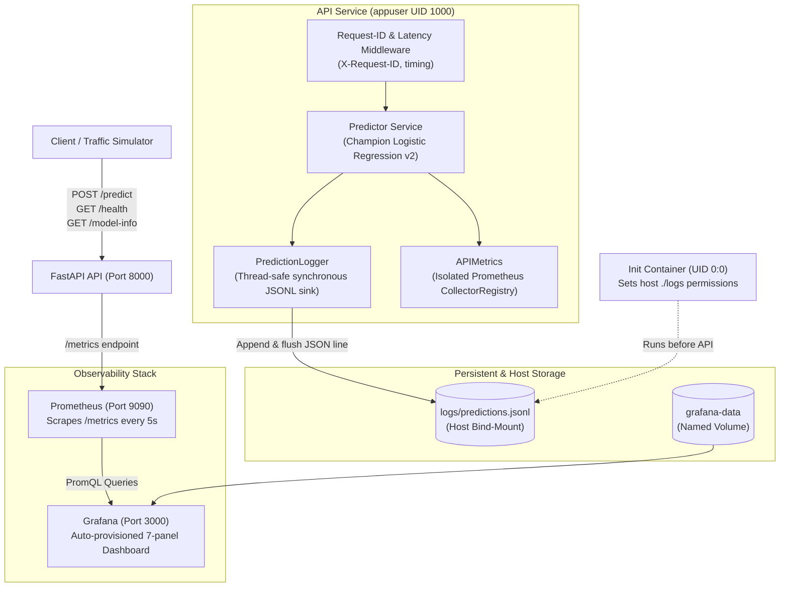

# Production Monitoring Runbook — Health & Wellness MLOps

This runbook documents the architecture, deployment, operation, verification, and troubleshooting of the production monitoring stack for the Cardiometabolic Risk Assessment API.

---

## 1. Monitoring Architecture

The monitoring infrastructure bridges API inference with request tracing, structured prediction logging, Prometheus metrics collection, and Grafana dashboards:



### Key Architectural Tenets
1. **Error-Isolated Observability**: Neither prediction logging nor metric recording can prevent FastAPI from starting or alter a successful HTTP 200 prediction response. Any I/O or metrics exception is caught and logged as a warning via the `health_api` logger.
2. **Cardinality Safety**: Prometheus HTTP metrics record bounded FastAPI route templates (e.g., `/predict`, `/health`, `/model-info`, or `unmatched`) rather than raw URLs or query strings. `GET /metrics` scrapes are excluded from `api_requests_total` and `api_request_latency_seconds`.
3. **Data Contract Compliance**: Successful `POST /predict` responses append one JSON line to `logs/predictions.jsonl`, nesting all 21 serving features under `"inputs"` to match the Phase 3 data contract.
4. **Non-Root Security & Secrets Hygiene**: The API container runs as non-root `appuser` (UID 1000, GID 1000). Host `./logs` bind-mount permissions are initialized safely by the `init` service, and Grafana requires an explicit `GRAFANA_ADMIN_PASSWORD` with no fallback default.

---

## 2. Docker Compose Services

The monitoring stack is defined in `docker-compose.yml` and runs four services:

| Service | Image / Build | Port | Container User | Depends On | Purpose |
|---|---|---|---|---|---|
| `init` | `python:3.11-slim` | None | `0:0` (root) | None | Creates `/app/logs` (`./logs` bind-mount), runs `chown -R 1000:1000 /app/logs` and `chmod -R 775 /app/logs`, then exits (`restart: "no"`). |
| `api` | Built from `Dockerfile` (`python:3.11-slim`) | `8000:8000` | `appuser` (UID 1000, GID 1000) | `init` (`condition: service_completed_successfully`) | Serves FastAPI endpoints, writes JSONL predictions to `./logs/predictions.jsonl`, and exposes `/metrics`. |
| `prometheus` | `prom/prometheus:v3.4.1` | `9090:9090` | Image default | `api` (`condition: service_healthy`) | Scrapes `api:8000/metrics` every 5 seconds using read-only `./monitoring/prometheus/prometheus.yml`. |
| `grafana` | `grafana/grafana:11.6.0` | `3000:3000` | Image default | `prometheus` | Serves pre-provisioned Prometheus datasource and 7-panel dashboard; persists state in named volume `grafana-data`. |

### Service Configuration Details

- **`init`**:
  ```yaml
  init:
    image: python:3.11-slim
    user: "0:0"
    volumes:
      - ./logs:/app/logs
    command: ["sh", "-c", "mkdir -p /app/logs && chown -R 1000:1000 /app/logs && chmod -R 775 /app/logs"]
    restart: "no"
  ```
  Resolves host bind-mount ownership mismatches when Docker initializes `./logs` as root so that the unprivileged `api` container (`appuser`, UID 1000) can append to `predictions.jsonl`.

- **`api`**:
  Mounts `./logs:/app/logs` and uses a Python healthcheck polling `http://localhost:8000/health` every 30s (`timeout: 3s`, `retries: 3`). `entrypoint.sh` checks write access to `PREDICTION_LOG_DIR` (default `/app/logs`) before starting `uvicorn src.api.main:app --host 0.0.0.0 --port "${PORT:-8000}"`.

- **`prometheus`**:
  Mounts `./monitoring/prometheus/prometheus.yml:/etc/prometheus/prometheus.yml:ro`. Configured in `monitoring/prometheus/prometheus.yml` with `scrape_interval: 5s`, `evaluation_interval: 15s`, job `health-wellness-api`, metrics path `/metrics`, and target `api:8000`.

- **`grafana`**:
  Mounts `grafana-data:/var/lib/grafana`, `./monitoring/grafana/provisioning:/etc/grafana/provisioning:ro`, and `./monitoring/grafana/dashboards:/var/lib/grafana/dashboards:ro`. Sets `GF_SECURITY_ADMIN_PASSWORD=${GRAFANA_ADMIN_PASSWORD}`.

---

## 3. Environment Setup & Prerequisites

### Prerequisites
- **Docker & Docker Compose**: Docker Engine / Docker Desktop with Compose v2 (`docker compose`).
- **Python 3.11**: Used locally to run the traffic simulator (`scripts/simulate_traffic.py`).
- **DVC**: Needed to pull the exported model (`models/model.skops`) and dataset (`data/processed/test.csv`).

### Environment Configuration
1. Clone the repository and enter the project directory:
   ```bash
   git clone https://github.com/Rishi799/health-wellness-mlops.git
   cd health-wellness-mlops
   ```

2. Copy `.env.example` to `.env`:
   ```bash
   cp .env.example .env
   ```

3. Set `GRAFANA_ADMIN_PASSWORD` in `.env`:
   ```bash
   # Replace the placeholder CHANGE_ME_BEFORE_RUNNING with a chosen password
   GRAFANA_ADMIN_PASSWORD=your_secure_password_here
   ```
   > [!IMPORTANT]
   > `docker-compose.yml` uses `${GRAFANA_ADMIN_PASSWORD}` without a `:-` fallback default. `.env` is gitignored and must not be committed.

4. Pull the DVC-tracked model and test dataset:
   ```bash
   dvc pull
   ```
   (Or pull only the champion model if `data/processed/test.csv` is already present: `dvc pull models/model.skops.dvc`.)
   Verify `models/model.skops`, `models/model_info.json`, and `data/processed/test.csv` exist locally.

---

## 4. Operational Commands & Verification

### 4.1 Startup
Build and start the four-service stack in detached mode:
```bash
docker compose up --build -d
```

Check container states:
```bash
docker compose ps
```
Verify that `init` completed with exit status `0`, `api` reports `healthy`, and `prometheus` and `grafana` are running (`Up`).

### 4.2 Health Checks & Target Verification
1. **API Health**:
   ```bash
   curl -s http://localhost:8000/health
   ```
   Expected response:
   ```json
   {"status":"healthy","model_loaded":true,"model_version":"2","error":null}
   ```

2. **Model Metadata**:
   ```bash
   curl -s http://localhost:8000/model-info
   ```

3. **Prometheus Metrics Exposition**:
   ```bash
   curl -s http://localhost:8000/metrics | head -n 30
   ```

4. **Prometheus Scrape Targets**:
   Open `http://localhost:9090/targets` in a browser (or query `curl -s http://localhost:9090/api/v1/targets`) and confirm the `health-wellness-api` target (`http://api:8000/metrics`) is `UP`.

5. **Grafana Web UI**:
   Open `http://localhost:3000` in a browser and log in with username `admin` and the password set in `GRAFANA_ADMIN_PASSWORD`.

### 4.3 Traffic Simulator Usage
Replay 20 valid records from `data/processed/test.csv` followed by 5 intentionally invalid payloads (`education: 2.5`) at 5 requests/second:

```bash
python -m scripts.simulate_traffic --batch data/processed/test.csv --rate 5 --limit 20 --bad 5
```

`scripts/simulate_traffic.py` extracts only the 21 serving features from `PredictionInput`, paces sequential HTTP `POST /predict` calls, and prints a JSON summary containing `sent`, `200`, `422`, `other`, `network_errors`, and `mean_latency_ms`:
```json
{
  "sent": 25,
  "200": 20,
  "422": 5,
  "other": 0,
  "network_errors": 0,
  "mean_latency_ms": "<varies by environment>"
}
```
The script exits with code `0` when `other == 0` and `network_errors == 0`, or code `1` otherwise.

### 4.4 Inspecting Prediction Logs
Inspect lines appended to the host bind-mounted JSONL file:
```bash
tail -n 3 logs/predictions.jsonl
wc -l logs/predictions.jsonl
```

### 4.5 Shutdown
Stop and remove containers and networks while keeping the `grafana-data` named volume:
```bash
docker compose down
```

Stop containers and also delete the `grafana-data` persistent volume:
```bash
docker compose down -v
```

---

## 5. JSONL Prediction Log Specification

### Location and Configuration
- **Default path**: `logs/predictions.jsonl` (configured via `PREDICTION_LOG_PATH` environment variable; inside the container with `WORKDIR /app`, this maps to `/app/logs/predictions.jsonl`, mounted from `./logs` on the host).
- **Startup check**: `entrypoint.sh` checks write access on `PREDICTION_LOG_DIR` (default `/app/logs`) and prints a warning if not writable without stopping Uvicorn.

### How `PredictionLogger` Works
Implemented in `src/api/monitoring.py` (`PredictionLogger`) and invoked from `POST /predict` in `src/api/main.py`:
- **Lifecycle**: Instantiated once at module import (`_prediction_logger = PredictionLogger()`). Directory creation (`mkdir(parents=True, exist_ok=True)`) and opening the file handle in append mode (`open("a", encoding="utf-8")`) are deferred to `_ensure_file()` on the first `log_prediction()` call.
- **Synchronous, Thread-Safe Writing**: `log_prediction()` serializes the JSON record and acquires `self.file_lock` (`threading.Lock()`) to synchronously write the line (`fh.write(line + "\n")`) and flush (`fh.flush()`). The lock protects concurrent threads within a single worker process (matching the default single-worker Uvicorn `CMD`); it does not coordinate across multiple worker processes.
- **Trigger Condition**: Invoked **only after** `predictor.predict(payload)` completes successfully (`HTTP 200`). Validation errors (`HTTP 422`), unavailable-model responses (`HTTP 503`), and inference errors (`HTTP 500`) do not call `PredictionLogger`.
- **Error Isolation**: Both `PredictionLogger.log_prediction()` and the caller in `src/api/main.py` catch any `Exception` and log a warning via `health_api` (`_logger.warning(...)`) so filesystem errors never break inference responses.
- **Privacy Separation**: Standard `health_api` request logs emitted to stdout/stderr record only `method`, `path`, `status`, `latency_ms`, and `request_id` — patient features are never logged to stdout/stderr.

### JSONL Record Structure
Each line is compact JSON (`separators=(",", ":")`) matching an entry such as:
```json
{
  "timestamp": "2026-11-21T03:23:02.429499+00:00",
  "request_id": "35812703-9033-4c3d-829c-d43d255b3e51",
  "model_version": "2",
  "latency_ms": 1.745,
  "inputs": {
    "age": 25,
    "sex": 2,
    "education": 4.0,
    "income_ratio": 4.5,
    "height_cm": 165.0,
    "weight_kg": 58.0,
    "bmi": 21.3,
    "waist_cm": 72.0,
    "sbp": 110.0,
    "dbp": 70.0,
    "pulse": 68.0,
    "told_high_bp": 0.0,
    "total_chol": 170.0,
    "hdl": 65.0,
    "smoking_status": "never",
    "alcohol_drinks_week": 0.0,
    "exercise_min_week": 240.0,
    "sedentary_min_day": 240.0,
    "sleep_hours": 8.0,
    "phq9_score": 1.0,
    "phq9_category": "minimal"
  },
  "probability": 0.0354,
  "risk_score": 3.5,
  "risk_band": "Low"
}
```

### Field Definitions

| Field | Type | Description |
|---|---|---|
| `timestamp` | String | Timezone-aware ISO-8601 UTC timestamp (`+00:00` suffix). |
| `request_id` | String | Validated incoming `X-Request-ID` (`^[A-Za-z0-9\-_]{1,128}$`) or auto-generated UUID v4; matches the `X-Request-ID` response header. |
| `model_version` | String | Loaded champion model version from `PredictionResponse` (e.g., `"2"`). |
| `latency_ms` | Float | Model inference duration (`predictor.predict`) in milliseconds, rounded to 3 decimal places. |
| `inputs` | Object | All 21 fields from `PredictionInput.model_dump()`; omitted optional features are serialized as `null`. |
| `probability` | Float | Predicted positive-class probability (`0.0`–`1.0`, rounded to 4 decimals by `Predictor.predict`). |
| `risk_score` | Float | Scaled cardiometabolic awareness score (`0.0`–`100.0`, rounded to 1 decimal). |
| `risk_band` | String | `"Low"` (`< 30.0`), `"Moderate"` (`30.0 <= score < 60.0`), or `"High"` (`>= 60.0`). |

---

## 6. Prometheus Metrics Specification

`APIMetrics` (`src/api/monitoring.py`) registers six application metrics inside an isolated `CollectorRegistry` (`METRICS_REGISTRY = create_metrics_registry()`), alongside standard `ProcessCollector`, `PlatformCollector`, and `GCCollector` runtime collectors, and exposes them at `GET /metrics`:

| Metric Name | Type | Labels | Buckets / Details |
|---|---|---|---|
| `api_requests_total` | Counter | `endpoint`, `method`, `status` | Total HTTP requests. Uses bounded FastAPI route templates (or `"unmatched"`). Excludes `GET /metrics` scrapes (non-GET calls to `/metrics` are counted). |
| `api_request_latency_seconds` | Histogram | `endpoint` | Request latency in seconds. Buckets: `(0.005, 0.01, 0.025, 0.05, 0.1, 0.25, 0.5, 1.0, 2.5, 5.0, 10.0)`. Excludes `GET /metrics` scrapes. |
| `predictions_total` | Counter | `risk_band` | Total successful predictions partitioned by `Low`, `Moderate`, or `High`. |
| `prediction_risk_score` | Histogram | None (`le` buckets) | Distribution of predicted risk scores (`0`–`100`). Buckets: `(0, 10, 20, 30, 40, 50, 60, 70, 80, 90, 100)`. |
| `prediction_probability` | Histogram | None (`le` buckets) | Distribution of predicted probabilities (`0.0`–`1.0`). Buckets: `(0.0, 0.1, 0.2, 0.3, 0.4, 0.5, 0.6, 0.7, 0.8, 0.9, 1.0)`. |
| `model_info` | Gauge | `model_name`, `model_version`, `git_commit` | Set to `1` during FastAPI lifespan startup when the model loads (`clear()` is called before setting, and on load failure). `git_commit` reads `SERVICE_GIT_COMMIT` (default `"unknown"`). |

---

## 7. Grafana Dashboard Panels

Grafana auto-provisions the Prometheus datasource (`monitoring/grafana/provisioning/datasources/prometheus.yml`, pointing to `http://prometheus:9090`) and loads dashboards from `/var/lib/grafana/dashboards` (`monitoring/grafana/provisioning/dashboards/dashboards.yml`).

The dashboard (`monitoring/grafana/dashboards/health-wellness-api.json`) is titled **Health & Wellness API** (`uid: health-wellness-api`, default window `now-30m` to `now`) and defines seven panels:

```
+-----------------------------------------------------------------------------------+
| [1] Requests per minute (w:12)            | [2] 4xx/5xx error rate (w:12)         |
+-----------------------------------------------------------------------------------+
| [3] Request latency p50 and p95 (w:24)                                            |
+-----------------------------------------------------------------------------------+
| [4] Predictions by risk band (w:12)       | [5] Average risk score over time(w:12)|
+-----------------------------------------------------------------------------------+
| [6] Risk score histogram (Heatmap) (w:12) |                                       |
+-----------------------------------------------------------------------------------+
| [7] Serving model version (Table) (w:24)                                          |
+-----------------------------------------------------------------------------------+
```

### Panel Reference

1. **Requests per minute** (`id: 1`, `type: timeseries`):
   - **PromQL**: `sum by (endpoint) (rate(api_requests_total[1m])) * 60`
   - **Purpose**: Tracks HTTP request rate per minute grouped by endpoint (`req/min`).

2. **4xx/5xx error rate** (`id: 2`, `type: timeseries`):
   - **PromQL**: `100 * sum(rate(api_requests_total{status=~"4..|5.."}[5m])) / sum(rate(api_requests_total[5m]))`
   - **Purpose**: Displays percentage (`0`–`100%`) of `4xx` (e.g., validation `422`) and `5xx` responses over total requests in a 5-minute window, rendered as a fixed red line.

3. **Request latency p50 and p95** (`id: 3`, `type: timeseries`):
   - **PromQL (p50)**: `histogram_quantile(0.50, sum by (le, endpoint) (rate(api_request_latency_seconds_bucket[5m])))`
   - **PromQL (p95)**: `histogram_quantile(0.95, sum by (le, endpoint) (rate(api_request_latency_seconds_bucket[5m])))`
   - **Purpose**: Monitors 50th and 95th percentile HTTP request latency in seconds per endpoint.

4. **Predictions by risk band** (`id: 4`, `type: timeseries`, stacked bars):
   - **PromQL**: `sum by (risk_band) (rate(predictions_total[5m]))`
   - **Purpose**: Shows prediction rate (`pred/s`, unit `reqps`) stacked by risk band (`Low` in green, `Moderate` in yellow, `High` in red).

5. **Average risk score over time** (`id: 5`, `type: timeseries`):
   - **PromQL**: `sum(rate(prediction_risk_score_sum[5m])) / sum(rate(prediction_risk_score_count[5m]))`
   - **Purpose**: Plots the moving average of predicted risk scores (`0`–`100`, fixed orange line) over 5-minute windows.

6. **Risk score histogram** (`id: 6`, `type: heatmap`):
   - **PromQL**: `sum(increase(prediction_risk_score_bucket[5m])) by (le)`
   - **Purpose**: Visualizes the distribution of predicted risk scores across histogram buckets over 5-minute windows (`Oranges` color scheme).

7. **Serving model version** (`id: 7`, `type: table`, instant query):
   - **PromQL**: `model_info`
   - **Purpose**: Displays a table of active model metadata with columns renamed to `Model Name`, `Model Version`, and `Git Commit` (excluding `Time`, `Value`, `__name__`, `instance`, and `job`).

---

## 8. Troubleshooting Guide

### 8.1 Missing Model Files
- **Symptom**: `docker compose build` fails at `COPY models/model.skops models/model_info.json models/`, or at runtime `/health` returns HTTP 503 (`{"status":"unhealthy","model_loaded":false,"model_version":null,"error":"Model is unavailable"}`).
- **Root Cause**: `models/model.skops` (DVC-tracked) or `models/model_info.json` is absent or invalid.
- **Fix**: Pull the model artifact with DVC, verify `models/model.skops` and `models/model_info.json` exist, and rebuild:
  ```bash
  dvc pull models/model.skops.dvc
  docker compose up --build -d
  ```

### 8.2 Grafana Login Issues
- **Symptom**: Login fails at `http://localhost:3000` with invalid credentials.
- **Root Cause**: `.env` is missing, `GRAFANA_ADMIN_PASSWORD` was not updated or exported before starting Compose, or the persistent `grafana-data` volume still holds a password from an earlier startup.
- **Fix**:
  1. Confirm `.env` exists and sets `GRAFANA_ADMIN_PASSWORD`.
  2. If the `grafana-data` volume was already initialized with a different password, reset it inside the running container:
     ```bash
     docker compose exec grafana grafana-cli admin reset-admin-password <new_password>
     ```

### 8.3 Missing Dashboard Data ("No data")
- **Symptom**: Grafana panels render "No data".
- **Root Cause**: No `/predict` or API requests have been sent yet, Prometheus has not completed enough 5-second scrapes for `rate(...[5m])` / `rate(...[1m])` queries, or the Grafana time range does not cover recent traffic.
- **Fix**:
  1. Send traffic using `python -m scripts.simulate_traffic --batch data/processed/test.csv --rate 5 --limit 20 --bad 5`.
  2. Wait 15–30 seconds for Prometheus to scrape multiple 5s intervals.
  3. Set the Grafana time picker to **Last 5 minutes** or **Last 15 minutes** and enable auto-refresh (e.g., `5s`).
  4. Verify target health at `http://localhost:9090/targets`.

### 8.4 Log Directory Permissions
- **Symptom**: `entrypoint.sh` logs `WARNING: /app/logs is not writable by appuser. Prediction logs will be skipped.` and `logs/predictions.jsonl` is not updated.
- **Root Cause**: `./logs` on the host has ownership or permissions preventing UID 1000 (`appuser`) from writing.
- **Fix**: In Docker Compose, the `init` service sets ownership to `1000:1000` and mode `775` before `api` starts. If running a standalone container (`docker run -v ./logs:/app/logs ...`) or locally, run:
  ```bash
  mkdir -p logs
  chmod 775 logs
  ```
  (And on Linux hosts if needed, `sudo chown -R 1000:1000 logs`.)

### 8.5 Simulator Errors
- **Symptom 1**: `Traffic simulation failed: ValueError: Remote demos are limited to 20 requests at 1 request/second; use localhost for batch traffic`.
  - **Fix**: Target `http://localhost:8000` (default `--api-url`) for batch runs exceeding 20 total requests or `rate > 1`.
- **Symptom 2**: `Traffic simulation failed: ValueError: Use an HTTP(S) API origin without credentials, paths or query strings`.
  - **Fix**: Pass only the base origin (e.g. `http://localhost:8000`), not `http://localhost:8000/predict`.
- **Symptom 3**: `Traffic simulation failed: FileNotFoundError` on `--batch`.
  - **Fix**: Run `dvc pull` so `data/processed/test.csv` exists locally.
- **Symptom 4**: Non-zero `network_errors` and exit code `1`.
  - **Fix**: Confirm `api` is healthy (`docker compose ps` and `curl -s http://localhost:8000/health`).

### 8.6 Port Conflicts
- **Symptom**: `docker compose up` fails with an error binding port `8000` (API), `9090` (Prometheus), or `3000` (Grafana).
- **Root Cause**: Another local server or container already holds one of those ports.
- **Fix**: Inspect listening processes and stop the conflicting service before restarting Compose:
  ```bash
  lsof -i :8000
  lsof -i :9090
  lsof -i :3000
  ```

---

## 9. Render Deployment & Ephemeral Filesystem Limitation

The public production API runs on Render's Free plan at `https://health-wellness-api.onrender.com`.

- **Ephemeral Disk**: Render's Free web service containers use an ephemeral filesystem. Every deployment, restart, or spin-up after the ~15-minute idle sleep clears local files inside the container, including `/app/logs/predictions.jsonl`.
- **Deployment Scope**: **Prometheus and Grafana are not deployed on Render.** Render runs only the standalone FastAPI container image published to GHCR; the full 4-service Docker Compose monitoring stack (`init`, `api`, `prometheus`, `grafana`) is intended for local execution or host/VM deployments with persistent storage.
- **Production Persistence Path**: Durable cloud monitoring requires forwarding prediction logs to external storage or log collectors (e.g., object storage or managed log pipelines) and running managed Prometheus/Grafana instances outside the ephemeral web dyno.

---

## 10. End-to-End Demonstration Procedure

Follow these steps to demonstrate the monitoring stack end-to-end:

1. **Pull DVC artifacts (`models/model.skops` and `data/processed/test.csv`)**:
   ```bash
   dvc pull
   ```

2. **Create `.env` and set `GRAFANA_ADMIN_PASSWORD`**:
   ```bash
   cp .env.example .env
   # Edit .env to replace CHANGE_ME_BEFORE_RUNNING with your chosen password
   ```

3. **Start the Docker Compose stack**:
   ```bash
   docker compose up --build -d
   ```

4. **Verify service health and endpoints**:
   ```bash
   docker compose ps
   curl -s http://localhost:8000/health
   curl -s http://localhost:8000/model-info
   ```

5. **Run the traffic simulator (20 valid rows + 5 invalid inputs)**:
   ```bash
   python -m scripts.simulate_traffic --batch data/processed/test.csv --rate 5 --limit 20 --bad 5
   ```
   Expected summary counts: `sent: 25`, `200: 20`, `422: 5`, `other: 0`, `network_errors: 0`.

6. **Inspect prediction logs written to host**:
   ```bash
   tail -n 3 logs/predictions.jsonl
   wc -l logs/predictions.jsonl
   ```

7. **Inspect exposed Prometheus metrics**:
   ```bash
   curl -s http://localhost:8000/metrics | grep -E "^(api_requests_total|predictions_total|model_info)"
   ```

8. **View the Grafana dashboard**:
   - Open `http://localhost:3000` and sign in (`admin` / `$GRAFANA_ADMIN_PASSWORD`).
   - Open the **Health & Wellness API** dashboard.
   - Set the time range to **Last 5 minutes** and refresh to **5s** to observe all seven panels (request rate, error percentage from the 5 HTTP 422 requests, p50/p95 latency, risk-band breakdown, average risk score, risk-score heatmap, and active model version table).

9. **Shut down the stack**:
   ```bash
   docker compose down
   ```
