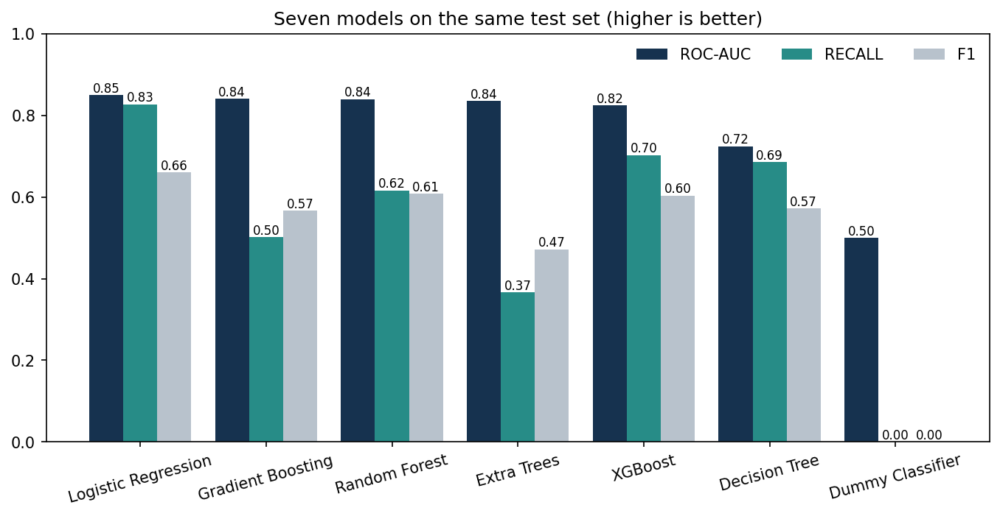
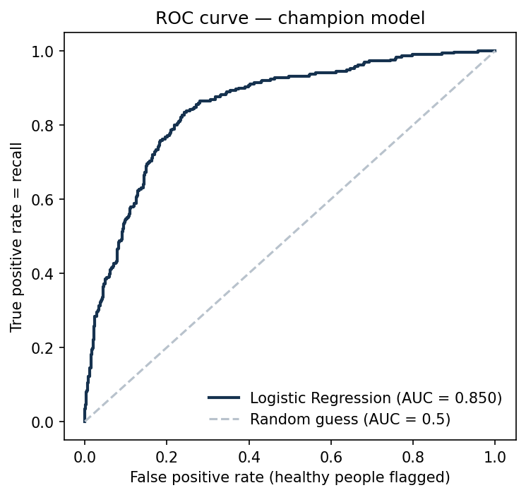
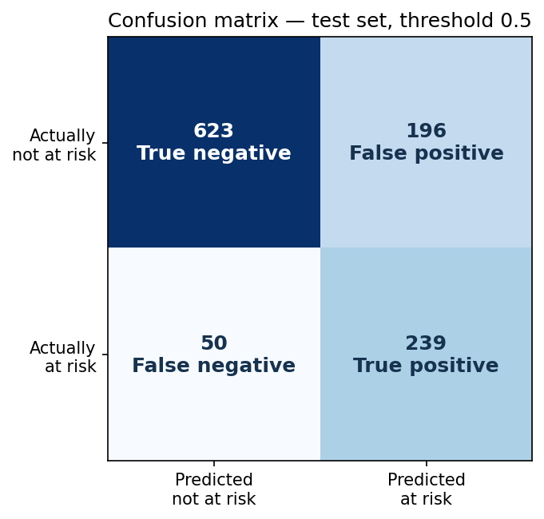
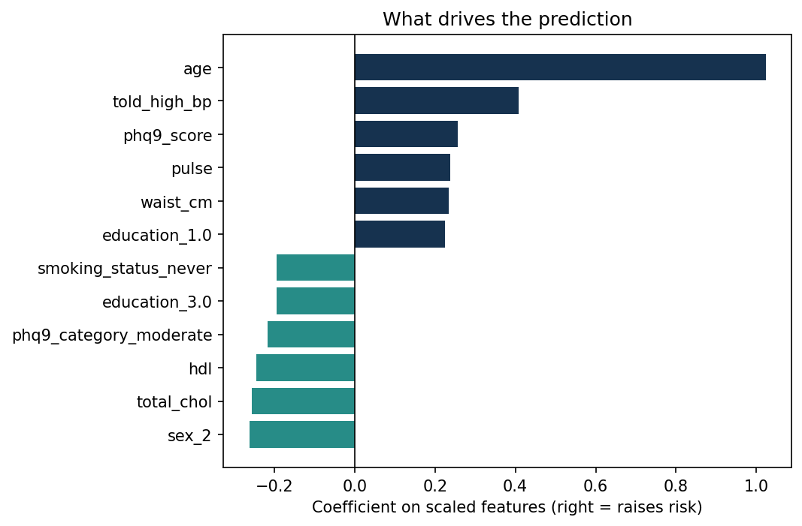
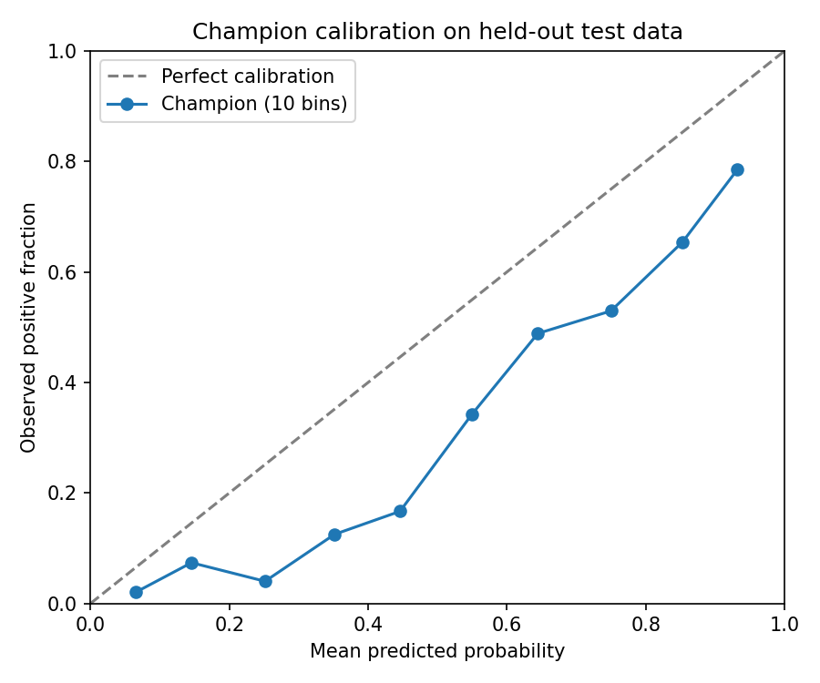
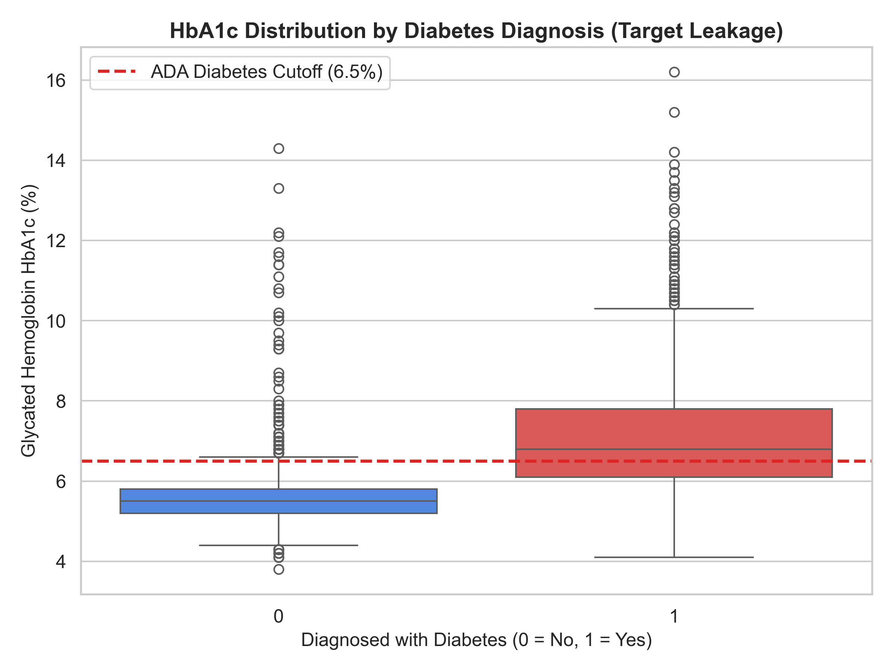
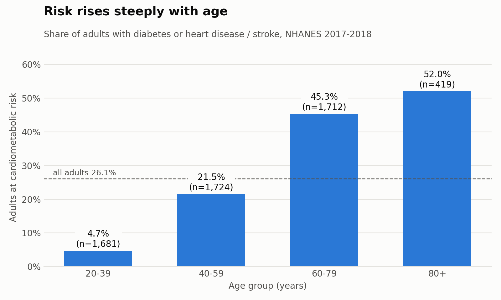
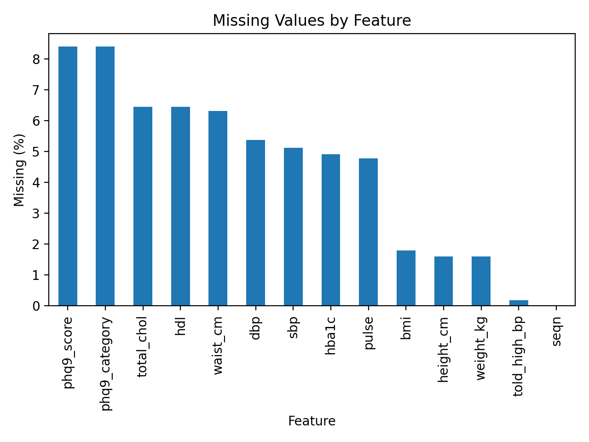

# Phase 2 Review Guide — answers with links to the code

Open this page on GitHub during the review. Every link opens the exact file and lines.
Code links point to the Phase 2 code at commit [`c42109d`](https://github.com/Rishi799/health-wellness-mlops/tree/c42109d61b5db9bf5a8b9e88e049c835c115e86a), so the line numbers never move.

**Live API:** https://health-wellness-api.onrender.com/docs (open `/health` one minute before the review; the free instance sleeps).

| # | Question | Jump |
| --- | --- | --- |
| 1 | Show and explain the CI/CD pipeline | [Q1](#q1-the-cicd-pipeline) |
| 2 | How does the code work — execution flow and important files | [Q2](#q2-how-the-code-works--execution-flow-and-important-files) |
| 3 | Which ML graphs are important and what each shows | [Q3](#q3-the-important-machine-learning-graphs) |
| 4 | Which ML artifacts are generated and used | [Q4](#q4-ml-artifacts-generated-and-used) |
| 5 | How FastAPI is implemented — endpoints and serving | [Q5](#q5-fastapi--endpoints-and-how-predictions-are-served) |
| 6 | The complete system end to end — which code implements each feature | [Q6](#q6-the-complete-system-end-to-end) |


---

## Q1. The CI/CD pipeline

**One-sentence answer:** every pull request is tested automatically by GitHub Actions (CI); when it is merged, a second workflow (CD) builds the Docker image, tests it, publishes it to GitHub Container Registry, deploys that exact commit to Render, and checks the live site is running it.

```
Pull request ─► CI ─────────────────────────────────────────────► merge ─► CD ───────────────────────────────► live
                1 Offline tests (no secrets)                              build image + smoke test
                2 Data checks and tests  (required)                       publish to GHCR (:commit, :latest)
                   dvc pull · dvc repro --force · 177 tests · quality gate deploy that commit to Render
                3 Docker image builds and starts (required)                verify live service_git_commit
```

### What to show — CI ([.github/workflows/ci.yml][ci])
| Show | Link | Say |
| --- | --- | --- |
| Triggers: every PR, push to main, manual | [ci.yml L11–16][ci-trig] | "It runs on every pull request and on main." |
| Job 1 — offline tests | [ci.yml L26–42][ci-off] | "Tests that need no data or passwords run first." |
| Job 2 — secrets → DVC | [ci.yml L71–85][ci-dvc] | "Passwords come from GitHub secrets; it downloads the exact data version." |
| Job 2 — reproducibility check | [ci.yml L87–92][ci-repro] | "It rebuilds the whole pipeline and fails if anything changes." |
| Job 2 — tests + quality gate | [ci.yml L94–111][ci-gate] | "177 tests, then the model must pass the quality gate; the report is uploaded." |
| Job 3 — Docker build + smoke test | [ci.yml L115–158][ci-dock] | "It builds the real image, starts it and makes a real prediction." |
| Smoke test logic | [scripts/smoke_test.py L32–69][smoke] | "Checks health, model identity, a prediction, bands, docs and that bad input is rejected." |

### What to show — CD ([.github/workflows/cd.yml][cd])
| Show | Link | Say |
| --- | --- | --- |
| Trigger: only after CI succeeds on main | [cd.yml L5–9][cd-trig], [L26–31][cd-if] | "CD never runs on untested code." |
| Reject stale release | [cd.yml L41–44][cd-stale] | "If main moved on, the newer commit is released instead." |
| Build, verify, then publish | [cd.yml L70–93][cd-build] | "The image is tested before it is pushed to GHCR." |
| Deploy and verify on Render | [cd.yml L95–99][cd-deploy], [scripts/render_deploy.py][rdeploy] | "It sends the exact commit image to Render and waits until the live site reports that commit." |

### Show it live on GitHub
1. **Actions** tab → latest **CI** run → three green jobs.
2. Latest **CD** run → step *Deploy SHA image and verify Render* → `Render accepted the SHA-pinned image … "status": "PASS"`.
3. **Settings → Branches** (or say): main requires 1 approval + checks *Data checks and tests* and *Docker image builds and starts*.
4. **Packages** (right sidebar) → `health-wellness-api` with one tag per commit (used for rollback).

**What blocks a merge:** a failing test · data breaking a validation rule · a pipeline that does not reproduce `dvc.lock` · a model below the quality gate · an image that does not start or predict.

**Likely follow-ups**
- *Where are the passwords?* GitHub encrypted secrets (`DAGSHUB_USER`, `DAGSHUB_TOKEN`, `RENDER_DEPLOY_HOOK`); never in code or the image.
- *How do you roll back?* Point Render at an earlier commit tag; drill recorded in [docs/render-deployment.md][runbook] (rollback 9704e43 → PASS, restore 0acf8cf → PASS).
- *Difference between CI and CD?* CI checks a change; CD ships a change that passed.

---

## Q2. How the code works — execution flow and important files

**One-sentence answer:** a DVC pipeline turns 15 raw NHANES files into a validated train/test split; training scripts compare 7 models in MLflow and export the champion; a FastAPI service loads that exported model to answer requests.

### Execution flow (in the order it runs)
| Step | Command | Code | What happens |
| --- | --- | --- | --- |
| 1 Get data | `dvc pull` (or `python download_nhanes.py`) | [download_nhanes.py L16–40][dl] | 15 CDC files, 9,254 people |
| 2 People + target | DVC stage `people_2017` | [people.py L71–80][target], [L84–112][pbuild] | adults 20+, target `cardiometabolic`, 5,536 adults, 26.1% at risk |
| 3 Body | `body_2017` | [body.py L70–130][bp], [L145][bmi] | BP average of valid readings, BMI 12–80 |
| 4 Lifestyle | `lifestyle_2017` | [lifestyle.py L157][smoke_rule], [L180][alc] | smoking, drinks/week, exercise, sleep |
| 5 Mental | `mental_2017` | [mental.py L8–17][phq] | PHQ-9 score and category |
| 6 Merge | `merge_2017` | [merge.py L50–75][merge] | left join on seqn → 5,536 × 31 |
| 7 Validate | `validate_2017` | [validate.py L109–124][vrules], [L243–256][vrun], [L448][vexit] | 358 checks; exit 1 stops the pipeline |
| 8 Split | `split` | [split.py L32–47][split] | stratified 80/20, seed 42 |
| 9 Train + compare | `python -m src.models.compare_models` | [compare_models.py L37–41][exclude], [L78–92][prep], [L94][models], [L275–300][fit] | 7 models, logged to MLflow |
| 10 Register | `python -m src.models.register_model` | [register_model.py L33][valid], [L146][reg], [L162][alias] | champion = v2 |
| 11 Export | `python -m src.models.export_model` | [export_model.py L169–198][export] | `models/model.skops` + `model_info.json` |
| 12 Quality gate | `python -m src.models.quality_gate` | [quality_gate.py L33–43][rules] | blocks weaker models |
| 13 Serve | `uvicorn src.api.main:app` | [main.py][main], [predictor.py][pred], [schemas.py][sch] | live predictions |

The whole data part is declared in [dvc.yaml][dvcyaml] (7 stages) — `dvc repro` runs steps 2–8 and reruns only what changed. Settings are in [params.yaml][params].

### Important files (role of each)
| File | Role |
| --- | --- |
| [dvc.yaml][dvcyaml] · `dvc.lock` | pipeline definition · fingerprints of every input and output |
| [src/data/people.py][people] | population and target (the answer we predict) |
| [src/data/merge.py][mergefile] | joins the four topic tables safely |
| [src/data/validate.py][validate] | pandera data-quality gate |
| [src/models/compare_models.py][cmp] | preprocessing pipeline, 7 models, MLflow logging |
| [src/models/register_model.py][regfile] · [export_model.py][expfile] | registry + safe export |
| [src/models/quality_gate.py][qg] | model quality and fairness checks |
| [src/api/][api] | FastAPI service |
| [Dockerfile][docker] | packages the service and model |
| [.github/workflows/][wf] | CI and CD |

**Likely follow-ups**
- *Where is leakage prevented?* [compare_models.py L37–41][exclude] excludes HbA1c, the target and its parts; imputation and scaling live inside the Pipeline so they are fitted on training data only ([L78–92][prep]).
- *What if validation fails?* [validate.py L448][vexit] returns 1, so DVC stops before the split.

---

## Q3. The important machine-learning graphs

All charts are in [reports/figures/](https://github.com/Rishi799/health-wellness-mlops/tree/main/reports/figures). The four evaluation charts are produced by [src/models/plot_evaluation.py](../src/models/plot_evaluation.py) from the real exported model and test set (`python -m src.models.plot_evaluation`).

| Graph | What it shows | Key message |
| --- | --- | --- |
| <br> **Model comparison** | ROC-AUC, recall and F1 of 7 models on the same 1,108 test people | Logistic Regression is best: AUC 0.850, recall 0.827 |
| <br> **ROC curve** | Recall vs false-alarm rate at every threshold | AUC 0.85: an at-risk person is ranked above a healthy one 85% of the time |
| <br> **Confusion matrix** | Caught / missed / false alarms at threshold 0.5 | 239 of 289 at-risk caught, 50 missed, 196 false alarms |
| <br> **Feature effects** | Logistic Regression coefficients on scaled features | Age dominates; high-BP diagnosis, PHQ-9, pulse, waist raise risk; HDL and female lower it |
| <br> **Calibration curve** | Predicted probability vs observed rate (from the quality gate) | Brier 0.162; high probabilities slightly over-estimated |
| <br> **HbA1c vs target** | HbA1c separates the classes at the 6.5% diabetes line | Proof of leakage → HbA1c excluded |
| <br> **Risk by age** | At-risk share by age group | 4.7% (20–39) → 52% (80+): age is the strongest factor |
| <br> **Missing values** | Missing share per column | Max ~14% → impute instead of dropping rows |

The subgroup recall (fairness) numbers are in [reports/model_quality.json](../reports/model_quality.json): men 0.887, women 0.769, ages 20–39 **0.118** (issue [#25](https://github.com/Rishi799/health-wellness-mlops/issues/25)).

**Likely follow-ups**
- *Why not accuracy?* The Dummy model reaches 0.739 accuracy while catching nobody.
- *Why is precision only 0.55?* We favour recall: missing an at-risk person is worse than a false alarm for an awareness tool.

---

## Q4. ML artifacts generated and used

An *artifact* is a file produced by one step and consumed by another.

| Artifact | Produced by | Where it lives | Used by |
| --- | --- | --- | --- |
| Raw NHANES files (30 XPT) | `download_nhanes.py` | DagsHub via [data/raw/nhanes.dvc](../data/raw/nhanes.dvc) | topic scripts |
| Topic tables + merged table | `src/data/*.py` | `data/interim/` (DVC) | validation, split |
| Validation report | `validate.py` | [reports/validation_2017-2018.json](../reports/validation_2017-2018.json) | DVC split stage (gate), reviewers |
| `train.csv`, `test.csv` | `split.py` | `data/processed/` (DVC) | training, quality gate, charts |
| Pipeline fingerprints | DVC | [dvc.lock](../dvc.lock) | CI reproducibility check |
| MLflow runs (params, metrics, tags, model) | `compare_models.py` | DagsHub MLflow experiment `cardiometabolic-model-comparison` | model selection |
| Model comparison table | `compare_models.py` | [reports/model_comparison.csv](../reports/model_comparison.csv) | charts, README |
| Registered model `cardiometabolic-risk-model` v2 (alias champion) | `register_model.py` | DagsHub Model Registry | export |
| **Exported model** `model.skops` | `export_model.py` | DagsHub via [models/model.skops.dvc](../models/model.skops.dvc) | API, quality gate, tests, Docker image |
| Model metadata | `export_model.py` | [models/model_info.json](../models/model_info.json) | API (`/model-info`, feature order) |
| Quality report + calibration plot | `quality_gate.py` | [reports/model_quality.json](../reports/model_quality.json), [calibration.png](../reports/figures/calibration.png) | CI artifact `model-quality-report`, model card |
| Model card | team | [docs/model_card.md](model_card.md) | reviewers, users |
| Docker image | CD | `ghcr.io/rishi799/health-wellness-api:<commit>` and `:latest` | Render |
| Live service | Render | https://health-wellness-api.onrender.com | users |

**Show:** [models/model_info.json](../models/model_info.json) (21 features, threshold 0.5, ROC-AUC 0.8502, recall 0.827, source run), and the DagsHub *Models* page (versions 1–2, alias champion → 2).

**Likely follow-up:** *Why export to a file instead of loading from MLflow?* The served model is exactly the tested artifact, and the service needs no DagsHub access at runtime. *Why skops?* Unlike pickle it only loads approved object types ([predictor.py L86–94][skops]).

---

## Q5. FastAPI — endpoints and how predictions are served

**One-sentence answer:** `src/api/` has three files — `schemas.py` validates input, `predictor.py` loads the exported model once and predicts, `main.py` defines the endpoints; uvicorn runs it in Docker on Render.

| Endpoint | Code | Returns |
| --- | --- | --- |
| `GET /health` | [main.py L57–84][health] | `healthy`, model loaded, version — or 503 |
| `GET /model-info` | [main.py L86–106][info] | model name/version, 21 features, metrics, `service_git_commit` |
| `POST /predict` | [main.py L108–137][predict] | probability, risk score, band, version, disclaimer |
| `GET /docs` | automatic (FastAPI) | interactive Swagger page |

### How a prediction is served (step by step)
1. **Start-up:** [main.py L29–41][lifespan] calls `predictor.load()` once. [predictor.py L71–112][load] checks the skops types, that metadata matches the API fields, feature order, classes `[0, 1]`, and runs one sample prediction — otherwise `/health` reports 503.
2. **Request arrives** at `POST /predict` with JSON.
3. **Validation** by pydantic — [schemas.py L11–180][input]: age 20–80 and sex required; ranges for numbers; exact allowed values for categories ([L47][edu], [L110][hbp], [L131][smk]); unknown fields and booleans rejected ([L20][forbid], [L24][bool]) → **HTTP 422**.
4. **Predict** — [predictor.py L114–150][predfn]: one-row table in training column order; missing fields → NaN; the exported pipeline imputes (training medians), scales, one-hot encodes and applies Logistic Regression → probability.
5. **Score and band** — [predictor.py L33–51][bands], [L137][score]: score = probability × 100; Low < 30, Moderate 30–59, High ≥ 60.
6. **Response** with model version and a not-a-diagnosis disclaimer.

**Demo (live):** `/docs` → POST /predict → Try it out:
```json
{"age": 55, "sex": 1, "bmi": 30.0, "sbp": 140.0, "told_high_bp": 1.0}
```
→ `probability 0.5965 · risk_score 59.6 · Moderate`. Then send `"education": 2.5` → **422**.

**Run locally:** `uvicorn src.api.main:app --reload` → http://localhost:8000/docs · in Docker: `docker compose up --build` ([Dockerfile][docker] L14 starts uvicorn).

**Tests:** [tests/test_api.py](../tests/test_api.py) (70) and [tests/test_api_contract.py](../tests/test_api_contract.py) (14).

---

## Q6. The complete system end to end

| # | Feature | Implemented in | Evidence |
| --- | --- | --- | --- |
| 1 | Data acquisition + versioning | [download_nhanes.py][dl], [data/raw/nhanes.dvc](../data/raw/nhanes.dvc), [.dvc/config](../.dvc/config) | 30 files on DagsHub |
| 2 | Cleaning + target | [src/data/people.py][people], body.py, lifestyle.py, mental.py | decision logs in `docs/` |
| 3 | Merge | [merge.py][merge] | 5,536 × 31 |
| 4 | Data validation | [validate.py][validate] | 358 checks, 0 failed |
| 5 | Reproducible pipeline | [dvc.yaml][dvcyaml], `dvc.lock`, [params.yaml][params], [.gitattributes](../.gitattributes) | `dvc status` up to date on Windows, Linux, macOS |
| 6 | Feature engineering + leakage control | [compare_models.py L37–92][exclude] | 21 features, HbA1c excluded |
| 7 | Model training + experiment tracking | [compare_models.py L201–330][cmpmain] | 7 MLflow runs |
| 8 | Model registry | [register_model.py][regfile] | v2 champion |
| 9 | Model export | [export_model.py][expfile] | `models/model.skops` |
| 10 | Model quality + fairness | [quality_gate.py][qg], [docs/model_card.md](model_card.md) | PASS; issue #25 |
| 11 | Evaluation charts | [plot_evaluation.py](../src/models/plot_evaluation.py) | `reports/figures/ml_*.png` |
| 12 | API | [src/api/][api] | live `/docs` |
| 13 | Tests | [tests/](../tests) | 177 passed |
| 14 | Container | [Dockerfile][docker], [requirements-api.txt](../requirements-api.txt), [docker-compose.yml](../docker-compose.yml) | 706.6 MB, ready in ~4 s |
| 15 | CI | [ci.yml][ci] | 3 jobs, 2 required |
| 16 | CD + deployment | [cd.yml][cd], [render_deploy.py][rdeploy], [smoke_test.py][smoke] | live on Render, verified commit |
| 17 | Rollback + evidence | [docs/render-deployment.md][runbook], [journey.md](../journey.md) | drill PASS 10 Nov |
| 18 | Release | tag [`phase2-review`](https://github.com/Rishi799/health-wellness-mlops/tree/phase2-review) | commit 0acf8cf |

**Two-minute walkthrough to say:** "Raw CDC files are versioned with DVC. Four scripts clean four topics; merge joins them; pandera validates 358 rules and stops the pipeline on failure; the split is stratified. We train seven models and track them in MLflow; Logistic Regression wins with AUC 0.85 and recall 0.83, is registered as version 2 and exported as one safe file. The quality gate blocks weaker models and reports fairness. FastAPI serves predictions from that file inside a Docker image. CI tests every pull request, and CD publishes the tested image and deploys the exact commit to Render, then verifies it — and we can roll back by commit."

---

### Commands to run live (PowerShell in the project folder)
```bash
.\.venv\Scripts\Activate.ps1
dvc dag                                    # pipeline graph
dvc status                                 # Data and pipelines are up to date
python -m src.data.validate --cycle 2017-2018
pytest -q                                  # 177 passed
python -m src.models.quality_gate          # PASS (+ one WARN)
python -m src.models.plot_evaluation       # regenerates the 4 ML charts
uvicorn src.api.main:app --reload            # http://localhost:8000/docs
```

[ci]: https://github.com/Rishi799/health-wellness-mlops/blob/c42109d61b5db9bf5a8b9e88e049c835c115e86a/.github/workflows/ci.yml
[ci-trig]: https://github.com/Rishi799/health-wellness-mlops/blob/c42109d61b5db9bf5a8b9e88e049c835c115e86a/.github/workflows/ci.yml#L11-L16
[ci-off]: https://github.com/Rishi799/health-wellness-mlops/blob/c42109d61b5db9bf5a8b9e88e049c835c115e86a/.github/workflows/ci.yml#L26-L42
[ci-dvc]: https://github.com/Rishi799/health-wellness-mlops/blob/c42109d61b5db9bf5a8b9e88e049c835c115e86a/.github/workflows/ci.yml#L71-L85
[ci-repro]: https://github.com/Rishi799/health-wellness-mlops/blob/c42109d61b5db9bf5a8b9e88e049c835c115e86a/.github/workflows/ci.yml#L87-L92
[ci-gate]: https://github.com/Rishi799/health-wellness-mlops/blob/c42109d61b5db9bf5a8b9e88e049c835c115e86a/.github/workflows/ci.yml#L94-L111
[ci-dock]: https://github.com/Rishi799/health-wellness-mlops/blob/c42109d61b5db9bf5a8b9e88e049c835c115e86a/.github/workflows/ci.yml#L115-L158
[cd]: https://github.com/Rishi799/health-wellness-mlops/blob/c42109d61b5db9bf5a8b9e88e049c835c115e86a/.github/workflows/cd.yml
[cd-trig]: https://github.com/Rishi799/health-wellness-mlops/blob/c42109d61b5db9bf5a8b9e88e049c835c115e86a/.github/workflows/cd.yml#L5-L9
[cd-if]: https://github.com/Rishi799/health-wellness-mlops/blob/c42109d61b5db9bf5a8b9e88e049c835c115e86a/.github/workflows/cd.yml#L26-L31
[cd-stale]: https://github.com/Rishi799/health-wellness-mlops/blob/c42109d61b5db9bf5a8b9e88e049c835c115e86a/.github/workflows/cd.yml#L41-L44
[cd-build]: https://github.com/Rishi799/health-wellness-mlops/blob/c42109d61b5db9bf5a8b9e88e049c835c115e86a/.github/workflows/cd.yml#L70-L93
[cd-deploy]: https://github.com/Rishi799/health-wellness-mlops/blob/c42109d61b5db9bf5a8b9e88e049c835c115e86a/.github/workflows/cd.yml#L95-L99
[rdeploy]: https://github.com/Rishi799/health-wellness-mlops/blob/c42109d61b5db9bf5a8b9e88e049c835c115e86a/scripts/render_deploy.py
[smoke]: https://github.com/Rishi799/health-wellness-mlops/blob/c42109d61b5db9bf5a8b9e88e049c835c115e86a/scripts/smoke_test.py#L32-L69
[runbook]: https://github.com/Rishi799/health-wellness-mlops/blob/c42109d61b5db9bf5a8b9e88e049c835c115e86a/docs/render-deployment.md
[dl]: https://github.com/Rishi799/health-wellness-mlops/blob/c42109d61b5db9bf5a8b9e88e049c835c115e86a/download_nhanes.py#L16-L40
[people]: https://github.com/Rishi799/health-wellness-mlops/blob/c42109d61b5db9bf5a8b9e88e049c835c115e86a/src/data/people.py
[target]: https://github.com/Rishi799/health-wellness-mlops/blob/c42109d61b5db9bf5a8b9e88e049c835c115e86a/src/data/people.py#L71-L80
[pbuild]: https://github.com/Rishi799/health-wellness-mlops/blob/c42109d61b5db9bf5a8b9e88e049c835c115e86a/src/data/people.py#L84-L112
[bp]: https://github.com/Rishi799/health-wellness-mlops/blob/c42109d61b5db9bf5a8b9e88e049c835c115e86a/src/data/body.py#L70-L130
[bmi]: https://github.com/Rishi799/health-wellness-mlops/blob/c42109d61b5db9bf5a8b9e88e049c835c115e86a/src/data/body.py#L145
[smoke_rule]: https://github.com/Rishi799/health-wellness-mlops/blob/c42109d61b5db9bf5a8b9e88e049c835c115e86a/src/data/lifestyle.py#L157-L176
[alc]: https://github.com/Rishi799/health-wellness-mlops/blob/c42109d61b5db9bf5a8b9e88e049c835c115e86a/src/data/lifestyle.py#L180-L205
[phq]: https://github.com/Rishi799/health-wellness-mlops/blob/c42109d61b5db9bf5a8b9e88e049c835c115e86a/src/data/mental.py#L8-L17
[merge]: https://github.com/Rishi799/health-wellness-mlops/blob/c42109d61b5db9bf5a8b9e88e049c835c115e86a/src/data/merge.py#L50-L75
[mergefile]: https://github.com/Rishi799/health-wellness-mlops/blob/c42109d61b5db9bf5a8b9e88e049c835c115e86a/src/data/merge.py
[validate]: https://github.com/Rishi799/health-wellness-mlops/blob/c42109d61b5db9bf5a8b9e88e049c835c115e86a/src/data/validate.py
[vrules]: https://github.com/Rishi799/health-wellness-mlops/blob/c42109d61b5db9bf5a8b9e88e049c835c115e86a/src/data/validate.py#L109-L124
[vrun]: https://github.com/Rishi799/health-wellness-mlops/blob/c42109d61b5db9bf5a8b9e88e049c835c115e86a/src/data/validate.py#L243-L256
[vexit]: https://github.com/Rishi799/health-wellness-mlops/blob/c42109d61b5db9bf5a8b9e88e049c835c115e86a/src/data/validate.py#L448
[split]: https://github.com/Rishi799/health-wellness-mlops/blob/c42109d61b5db9bf5a8b9e88e049c835c115e86a/src/data/split.py#L32-L47
[dvcyaml]: https://github.com/Rishi799/health-wellness-mlops/blob/c42109d61b5db9bf5a8b9e88e049c835c115e86a/dvc.yaml
[params]: https://github.com/Rishi799/health-wellness-mlops/blob/c42109d61b5db9bf5a8b9e88e049c835c115e86a/params.yaml
[cmp]: https://github.com/Rishi799/health-wellness-mlops/blob/c42109d61b5db9bf5a8b9e88e049c835c115e86a/src/models/compare_models.py
[exclude]: https://github.com/Rishi799/health-wellness-mlops/blob/c42109d61b5db9bf5a8b9e88e049c835c115e86a/src/models/compare_models.py#L37-L41
[prep]: https://github.com/Rishi799/health-wellness-mlops/blob/c42109d61b5db9bf5a8b9e88e049c835c115e86a/src/models/compare_models.py#L78-L92
[models]: https://github.com/Rishi799/health-wellness-mlops/blob/c42109d61b5db9bf5a8b9e88e049c835c115e86a/src/models/compare_models.py#L94-L121
[fit]: https://github.com/Rishi799/health-wellness-mlops/blob/c42109d61b5db9bf5a8b9e88e049c835c115e86a/src/models/compare_models.py#L275-L300
[cmpmain]: https://github.com/Rishi799/health-wellness-mlops/blob/c42109d61b5db9bf5a8b9e88e049c835c115e86a/src/models/compare_models.py#L201-L329
[regfile]: https://github.com/Rishi799/health-wellness-mlops/blob/c42109d61b5db9bf5a8b9e88e049c835c115e86a/src/models/register_model.py
[valid]: https://github.com/Rishi799/health-wellness-mlops/blob/c42109d61b5db9bf5a8b9e88e049c835c115e86a/src/models/register_model.py#L33-L56
[reg]: https://github.com/Rishi799/health-wellness-mlops/blob/c42109d61b5db9bf5a8b9e88e049c835c115e86a/src/models/register_model.py#L146
[alias]: https://github.com/Rishi799/health-wellness-mlops/blob/c42109d61b5db9bf5a8b9e88e049c835c115e86a/src/models/register_model.py#L162
[expfile]: https://github.com/Rishi799/health-wellness-mlops/blob/c42109d61b5db9bf5a8b9e88e049c835c115e86a/src/models/export_model.py
[export]: https://github.com/Rishi799/health-wellness-mlops/blob/c42109d61b5db9bf5a8b9e88e049c835c115e86a/src/models/export_model.py#L169-L198
[qg]: https://github.com/Rishi799/health-wellness-mlops/blob/c42109d61b5db9bf5a8b9e88e049c835c115e86a/src/models/quality_gate.py
[rules]: https://github.com/Rishi799/health-wellness-mlops/blob/c42109d61b5db9bf5a8b9e88e049c835c115e86a/src/models/quality_gate.py#L33-L43
[api]: https://github.com/Rishi799/health-wellness-mlops/tree/c42109d61b5db9bf5a8b9e88e049c835c115e86a/src/api
[main]: https://github.com/Rishi799/health-wellness-mlops/blob/c42109d61b5db9bf5a8b9e88e049c835c115e86a/src/api/main.py
[pred]: https://github.com/Rishi799/health-wellness-mlops/blob/c42109d61b5db9bf5a8b9e88e049c835c115e86a/src/api/predictor.py
[sch]: https://github.com/Rishi799/health-wellness-mlops/blob/c42109d61b5db9bf5a8b9e88e049c835c115e86a/src/api/schemas.py
[health]: https://github.com/Rishi799/health-wellness-mlops/blob/c42109d61b5db9bf5a8b9e88e049c835c115e86a/src/api/main.py#L57-L84
[info]: https://github.com/Rishi799/health-wellness-mlops/blob/c42109d61b5db9bf5a8b9e88e049c835c115e86a/src/api/main.py#L86-L106
[predict]: https://github.com/Rishi799/health-wellness-mlops/blob/c42109d61b5db9bf5a8b9e88e049c835c115e86a/src/api/main.py#L108-L137
[lifespan]: https://github.com/Rishi799/health-wellness-mlops/blob/c42109d61b5db9bf5a8b9e88e049c835c115e86a/src/api/main.py#L29-L41
[load]: https://github.com/Rishi799/health-wellness-mlops/blob/c42109d61b5db9bf5a8b9e88e049c835c115e86a/src/api/predictor.py#L71-L112
[skops]: https://github.com/Rishi799/health-wellness-mlops/blob/c42109d61b5db9bf5a8b9e88e049c835c115e86a/src/api/predictor.py#L86-L94
[predfn]: https://github.com/Rishi799/health-wellness-mlops/blob/c42109d61b5db9bf5a8b9e88e049c835c115e86a/src/api/predictor.py#L114-L150
[bands]: https://github.com/Rishi799/health-wellness-mlops/blob/c42109d61b5db9bf5a8b9e88e049c835c115e86a/src/api/predictor.py#L33-L51
[score]: https://github.com/Rishi799/health-wellness-mlops/blob/c42109d61b5db9bf5a8b9e88e049c835c115e86a/src/api/predictor.py#L137
[input]: https://github.com/Rishi799/health-wellness-mlops/blob/c42109d61b5db9bf5a8b9e88e049c835c115e86a/src/api/schemas.py#L11-L180
[edu]: https://github.com/Rishi799/health-wellness-mlops/blob/c42109d61b5db9bf5a8b9e88e049c835c115e86a/src/api/schemas.py#L47
[hbp]: https://github.com/Rishi799/health-wellness-mlops/blob/c42109d61b5db9bf5a8b9e88e049c835c115e86a/src/api/schemas.py#L110
[smk]: https://github.com/Rishi799/health-wellness-mlops/blob/c42109d61b5db9bf5a8b9e88e049c835c115e86a/src/api/schemas.py#L131
[forbid]: https://github.com/Rishi799/health-wellness-mlops/blob/c42109d61b5db9bf5a8b9e88e049c835c115e86a/src/api/schemas.py#L20
[bool]: https://github.com/Rishi799/health-wellness-mlops/blob/c42109d61b5db9bf5a8b9e88e049c835c115e86a/src/api/schemas.py#L22-L28
[docker]: https://github.com/Rishi799/health-wellness-mlops/blob/c42109d61b5db9bf5a8b9e88e049c835c115e86a/Dockerfile
[wf]: https://github.com/Rishi799/health-wellness-mlops/tree/c42109d61b5db9bf5a8b9e88e049c835c115e86a/.github/workflows
